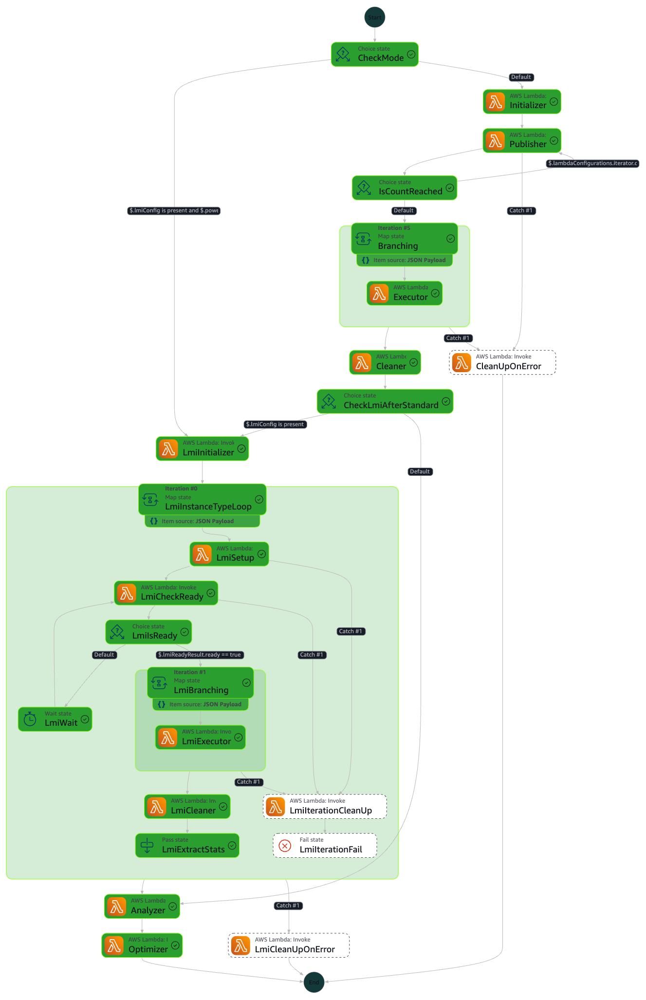
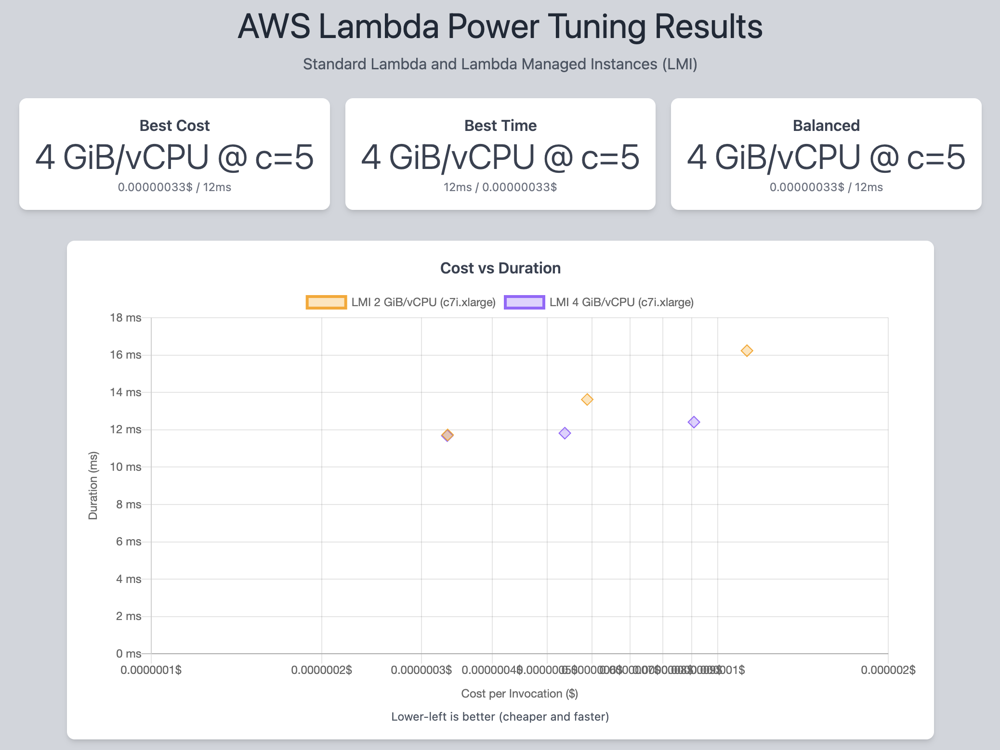
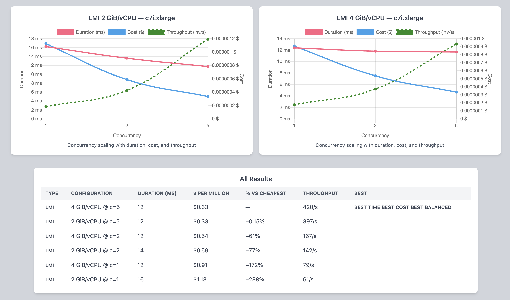

# Lambda Managed Instances (LMI) Support

AWS Lambda Power Tuning optionally supports [Lambda Managed Instances](https://docs.aws.amazon.com/lambda/latest/dg/lambda-managed-instances.html) (LMI), which run Lambda functions on dedicated EC2 instances with configurable memory-per-vCPU ratios and concurrency levels.

## Why LMI?

Standard Lambda allocates memory (128MB-10,240MB) and proportionally scales CPU. LMI gives you direct control over the underlying instance type, memory-per-vCPU ratio, and per-execution-environment concurrency. This can provide significantly lower per-invocation costs at high concurrency while maintaining consistent performance.

## Enabling LMI support

LMI support is opt-in at deploy time. Set the `enableLmiSupport` CloudFormation parameter to `true` when deploying the stack:

```bash
sam deploy --parameter-overrides "enableLmiSupport=true"
```

When disabled (the default), no LMI Lambda functions or IAM policies are deployed. See [deployment parameters](README-DEPLOY.md#state-machine-configuration-at-deployment-time) for all available options.

## How it works



When you provide an `lmiConfig` input parameter, the state machine will:

1. Run standard Lambda power tuning (if `powerValues` is also provided)
2. For each instance type, create a capacity provider and a dedicated LMI function (cloned from your function's code)
3. Test each memory-per-vCPU configuration across multiple concurrency levels using sustained load
4. Detect concurrency degradation and stop ramping automatically
5. Clean up all LMI resources (capacity provider, function versions)
6. Move to the next instance type (if multiple are configured)
7. Analyze all results together and recommend the optimal configuration

> **Note on large functions**: the dedicated LMI function is cloned from your source function's deployment package. The source code is staged through an S3 bucket (created automatically when LMI support is enabled) rather than uploaded inline, so functions larger than 50&nbsp;MB (the inline upload limit) are supported up to the standard 250&nbsp;MB unzipped package limit. Staged objects are deleted immediately after each LMI function is created, with a 1-day lifecycle rule as a backstop.

## Input example

```json
{
    "lambdaARN": "your-lambda-function-arn",
    "num": 10,
    "powerValues": [128, 512, 1024, 1769, 2048, 4096],
    "payload": {},
    "strategy": "cost",
    "lmiConfig": {
        "vpcConfig": {
            "subnetIds": ["subnet-VVV"],
            "securityGroupIds": ["sg-WWW"]
        },
        "operatorRoleArn": "arn:aws:iam::YYY:role/LmiOperatorRole",
        "instanceTypes": ["c8g.xlarge", "c8g.2xlarge"],
        "architecture": "arm64",
        "memoryPerVCpuValues": [2.0, 4.0],
        "concurrencyValues": [1, 5, 10, 20, 50, 100],
        "testDurationSeconds": 30,
        "degradationThreshold": 0.2
    }
}
```

> **Note**: `degradationThreshold` is optional. When set (e.g. `0.2`), the tool stops testing higher concurrency levels once latency degrades by more than the specified fraction. When omitted, all concurrency values are tested.

## Prerequisites

- A VPC with subnets that have internet access (or VPC endpoints for Lambda)
- An IAM operator role with the `AWSLambdaManagedEC2ResourceOperator` managed policy
- The Lambda function's execution role must also have the `AWSLambdaManagedEC2ResourceOperator` managed policy
- The function must use a [supported LMI runtime](https://docs.aws.amazon.com/lambda/latest/dg/lambda-managed-instances.html)

## Output

When both standard and LMI results are available, the output includes all visualization URLs:

```json
{
    "power": 4,
    "cost": 3.34e-7,
    "duration": 29.1,
    "type": "lmi",
    "memoryPerVCpu": 4,
    "bestConcurrency": 10,
    "instanceType": "c8g.xlarge",
    "stateMachine": {
        "executionCost": 0.00098,
        "lambdaCost": 0.00376,
        "visualization": "https://lambda-power-tuning.show/#...",
        "lmiVisualization": {
            "2.0": "https://lambda-power-tuning.show/#...",
            "4.0": "https://lambda-power-tuning.show/#..."
        },
        "combinedVisualization": "https://lambda-power-tuning.show/combined.html#..."
    }
}
```

- **visualization**: standard Lambda results (memory on x-axis)
- **lmiVisualization**: per-memoryPerVCpu URLs with concurrency on x-axis
- **combinedVisualization**: unified view comparing all standard and LMI configurations





## Execution modes

| Input | Mode | Description |
|---|---|---|
| `powerValues` only | Standard | Classic power tuning (unchanged) |
| `lmiConfig` only | LMI-only | Tests LMI configurations only |
| Both `powerValues` and `lmiConfig` | Combined | Runs standard first, then LMI, compares all results |

See the full [LMI configuration reference](README-EXECUTE.md#lmi-configuration) for all parameters.
